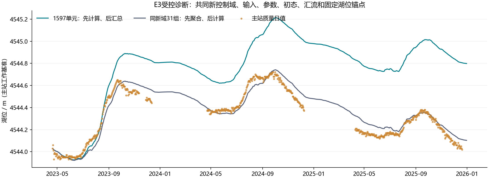
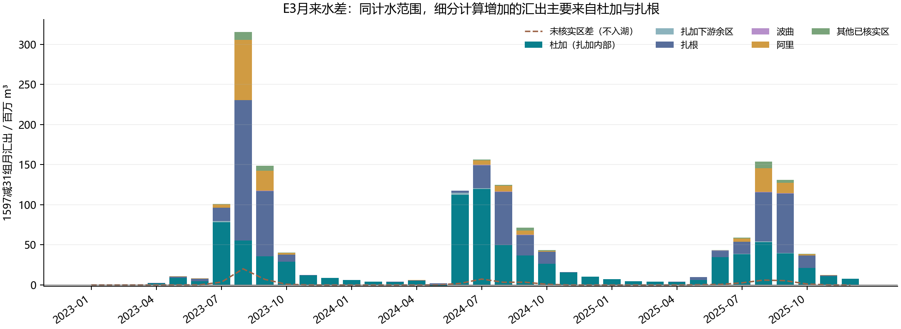

> Git 整理现行说明（2026-10-27）：下文保留原报告与科学数值。文中“0.10尚未部署”“0.9.0默认”等是报告形成时的状态；当前软件交付范围以[现行执行台账](整改执行台账-现行.md)为准。E3仍未通过科学准入，默认成果身份未变。

# E3同新域聚合顺序受控诊断（2026-10-27）

本副本纳入0.10.0准备文档，科学数值与源证据保持冻结。0.10尚未部署/完整验收；0.9安装证据继续有效。下文独立E3运行不是0.10发布或新默认科学通过。

已完成两个31日均匀驱动数值等价控制及两个真实2023—2025完整臂，未优化参数、改观测、写原数据库或升级默认。31组是由新控制域1597单元合成，**不是旧30单元方案**。本试验隔离同新域内“先非线性计算后汇总／先聚合有效驱动后计算”的影响，不证明空间越粗越科学。E4原生地形修订仍缺资料，未运行。

## 1. 固定了什么、只变了什么

真实输入`INPUT-3faa73605321b03d4a9f6bf7`实际文件SHA已核对`c7b8672e0300244010a9b8ea4f072b5117d2274e4b792164b44369fd69d5dc14`；535格网、湖面转换、参数及杜加覆盖值、完整冻结质量观测快照、2023-01-01 00:00起点、0.5容量土壤初值、零雪/液态/自由水/汇流储量、八分区源分离汇流、未核实区排除、湖面面积及权重完全相同。两臂湖面P/E逐小时bit-identical；杜加在扎加中仅加一次。

锚点固定2023-04-20 12:00、4544.03米；锚点之后连续积分。温度先逐成员按同一原DEM格网参考高程和递减率修正，再按面积聚合，粗臂不再重复递减。31组按partition×500米垂直带×陆面/冰川构造，全部1597成员各出现一次，各组面积权重和为1。代码复用只读`model_core`/`parameter_regions`/`routing`，独立脚本有真实源摘要，未伪造既有模型身份。

唯一区别是内核输入与空间状态组织：细臂1597单元独立响应局地P/T/E后汇体积；粗臂31组先把相同有效P/T/E面积平均再进同一内核。参数没有重新率定、初态没有按分数挑选、2025/2026没有成为新的未触碰外部验证。

## 2. 数值控制与复现

短控制用真实2023年1月驱动，但每组所有细成员统一喂该组平均有效P/T/E，再与31组计算对照。这是数值等价检查，不能作为模型科学精度证据。控制各有745个保存时刻（包含起止小时），完整31业务日之外另有起点初始小时。

- 小时源体积最大差：1.78e-15m³；汇流储量最大差：2.84e-14m³。
- 流量最大差：1.58e-17m³/s；完整月/首尾部分月水量摘要最大差：9.54e-07m³。
- 组平均末状态最大差：7.11e-14（水量状态mm，FR为无量纲）。全部小于预先配置容差，完整臂在此后执行。
- 真实细臂对保存基线日Duja/total/lake最大差约5e-11，符合原JSON日值小数保存舍入量级；证明共同适配器忠实复现本次细臂基线。
- 月水量按内核真实储水式`swe+snow_liquid+WU+WL+WD+S×FR`（陆面）或`swe+snow_liquid+glacier_storage`（冰川）核算；FR比例不能当毫米相加。细/粗分区月最大记账残差分别0.000158/6.92e-05m³。裸冰仍为外部冰水源，不代表有限冰储量闭合。

时间戳是小时末。月表按减1纳秒后归月，因此2023-01-01 00:00这一初始小时归2022-12，形成一个1小时的部分月；完整年度评价只取2024/2025冻结共同日，不把该部分月当完整2022年证据。

## 3. 年度同口径结果

下表顺序均为1597细臂／同新域31组粗臂。评分日列表及SHA严格引用已冻结协议；lake与flow各自同一共同日。

| 年份 | 湖位共同日 | RMSE/m 细/粗 | 平均偏差/m 细/粗 | 杜加共同日 | NSE 细/粗 | PBIAS/% 细/粗 |
|---|---:|---:|---:|---:|---:|---:|
| 2024 | 232 | 0.421687 / 0.063756 | 0.400427 / 0.005031 | 229 | 0.472804 / 0.529088 | +17.0423 / -5.3002 |
| 2025 | 255 | 0.648301 / 0.062308 | 0.644982 / 0.048874 | 211 | 0.595688 / 0.725526 | +19.3072 / -2.9552 |

粗臂湖位明显改善，但它尚不是发布候选：与旧同口径连续参考相比，2024杜加NSE 0.52908826 < 旧连续参考0.52928669；2024杜加绝对PBIAS 5.30024883% > 旧参考5.24294454%；2025杜加绝对PBIAS 2.95519547% > 旧参考2.89511836%。这些数值冲突已不满足“各年核心指标不退步”，同时长预热/干湿初态、完整发布产物与严格续算尚未通过。不能用湖位单项改善升级默认或把不同任务指标拼接。

## 4. 计水和过程差异

细减粗：2024已核实入湖量差561.278百万m³，2025为476.405百万m³；湖面P/E差均为0，因此净水量差来自冻结模型中的陆域产汇流组织差异。以下表是各区汇出差及ET/融雪/融冰差，仍不能将融雪差直接重复加到河流入湖量。

| 年份 | 分区 | 汇出差/百万m³ | ET差/百万m³ | 融雪差/百万m³ | 融冰差/百万m³ |
|---|---|---:|---:|---:|---:|
| 2024 | 阿里 | 20.090 | -9.727 | 19.395 | 0.000 |
| 2024 | 波曲 | 1.755 | -4.667 | 0.501 | 0.000 |
| 2024 | 杜加（扎加内部） | 388.099 | -310.674 | 191.355 | 2.095 |
| 2024 | external | 0.000 | 0.000 | 0.000 | 0.000 |
| 2024 | 其他已核实区 | 6.594 | -8.458 | 1.737 | 0.000 |
| 2024 | unresolved | 16.926 | -21.600 | 9.880 | 0.000 |
| 2024 | 扎根 | 141.162 | -185.039 | 76.995 | 2.560 |
| 2024 | 扎加下游余区 | 3.578 | -3.789 | 2.116 | 0.075 |
| 2025 | 阿里 | 48.831 | -125.903 | 19.117 | 0.000 |
| 2025 | 波曲 | 1.290 | -3.700 | 1.586 | 0.000 |
| 2025 | 杜加（扎加内部） | 231.091 | -450.963 | 150.147 | 1.381 |
| 2025 | external | 0.000 | 0.000 | 0.000 | 0.000 |
| 2025 | 其他已核实区 | 14.152 | -38.439 | 1.355 | 0.000 |
| 2025 | unresolved | 16.260 | -46.259 | 10.396 | 0.000 |
| 2025 | 扎根 | 179.032 | -413.272 | 126.264 | 3.260 |
| 2025 | 扎加下游余区 | 2.010 | -1.592 | 1.232 | 0.026 |

未核实区独立保存，不进入已核实入湖量。上述结果支持“当前参数在细驱动分布与非线性产流作用下产生较多来水，聚合顺序是本次新域内差异的明确贡献因素”，尚不能把以前旧/新全部差值都归因于该项。两臂也都可能受驱动代表性和初态限制；粗臂较好拟合可能含误差抵消，需要独立资料及后续受控诊断。

## 5. 文件、运行与下一步

产物在本轮实施根`evidence/diagnostics/e3-run`：receipt、控制、两臂日过程/分区月水量/初末状态、共同日期、月及年差值、两张PNG/PDF、源输入/脚本/配置/数值源摘要和最后重建的output-sha256清单。独立runner为本轮根`run_e3_controlled.py`；运行可通过创建产物目录`CANCEL`停止。最终4run用时50.71秒，RSS每168小时采样最大491.9MiB，不是连续峰值，也不作为业务查询性能验收。

第一次运行的月储水摘要把状态直接相加，自审后修正为内核水量式并完整重跑4run；旧摘要保留在`revision1-superseded-storage-summary`，不作为科学结论，最终流量/湖位指标与首轮一致。本报告与主receipt采用最终复跑结果。

下一步优先分解杜加与扎根的产流/雪冰/ET与储量差，检查实测约束和非线性温度/降水代表性；随后有依据地设计驱动或区域参数实验。E4无真实原生地形和独立递减率约束仍阻塞；更长真实预热和干湿初态试验继续未通过。不扩预算盲搜，不改0.9.0默认与数值代码。
