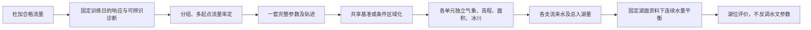

# 新安江参数审计与传递

本次为第三轮整改中优先插入的实际修复，审查旧采用配置及尚未提交的第三轮代码。保留旧方案、冻结成果和原始资料。完整机器证据见[参数作用与率定审计](evidence/第三轮参数作用与率定审计-20261028.json)；实算对照、最终参数与运行身份在本页后半部及[真实对照收据](evidence/杜加参数传递真实对照-20261028.json)。

## 审计结论：先区分错误与假设

**确认的代码错误。**旧 `calibration.py` 的 `uniform/None` 分支只改 `parameters`，却继续带着 `partitionParameters.duja`。后者若覆盖搜索键，杜加实际计算不使用被搜索的全局值，目标可完全不变。原 `grid_calibration.py` 直接调用亦缺防御；常规新方案的 `research_schemes.validate` 当时已拒绝 `target=duja` 配非杜加 scope，不能把错误扩大成“所有历史率定都无效”。修复前隔离试验曾记录8个WM候选目标同为51.9325249485；其原脚本现在会被新增防线拒绝，不将历史摘要冒充现脚本可重跑的完整轨迹。

修复后的[自动回归轨迹](evidence/第三轮参数遮蔽自动回归-20261028.json)另用明确标识的合成驱动和真实模型内核独立复现：全局WM取40、65、90、120、150、190、240、300，杜加完整覆盖固定150，杜加Q及目标差均为0，而扎根Q最大变化23.66548 m³/s；改杜加WM后杜加Q最大变化4.43728 m³/s、目标范围51.79576。此处合成条件与修复前试验不同，不混用数值。测试还同时确认旧入口遇遮蔽明确拒绝，新入口在运行前和优化器内均校验作用范围。

**确认的来源局限。**当前全局向量不是一组无来源的常数：7项值可追溯到2026-10-22的120次杜加流量搜索，湖面系数1.5来自另30次湖位搜索，其他项主要沿用通用概念初值。旧依据是[0.4记录](historical-results-v0.4.0.json)，任务为 `JOB-1de857c58b73448e801d` 与 `JOB-25a4e32481394e928ca7`。这些值跨旧模型结构和空间沿用，不能据此称当前其他流域已经率定。

杜加覆盖来源为2026-10-23三种子分阶段试验选择的142路径，见[当日报告](模型方案收敛与分区参数复核-20261023.md)和[冻结配置](../config/model-candidates/duja-regional-20261023.json)。它只进入杜加是当时明确的控制变量决策，目的在于不把单站拟合当成全域实证；缺点是“背景参考”不等于有可靠区域移植依据。此次用独立可复现的移植方案检验，不悄悄改写这个历史决定。

**不能靠加预算解决的科学问题。**当前只有229个2024年杜加合格配对日，空间上仍是单站约束。2025、2026已参与开发和比较，只是本次搜索不使用的时间留出，不能改称全新外部验证。WM、B、SM、KG、地下退水时间等存在触边，历史陆面240次、汇流120次的三个种子均耗尽预算、未收敛。120+120没有通用“足够”的保证；局部响应也不能证明参数唯一。

## 完整参数及可观测性

本实现有25个显式参数：9项陆面、4项汇流、11项雪冰及高程、1项湖面。不是所有标准新安江参数都独立存在：上/下/深层容量固定按 WM 的2/15、8/15、1/3划分，融化阈值0℃、初始张力水50%、固定冰川/湖面面积等也是结构假设，不能把它们遗漏后声称“全物理参数已率定”。

下表“范围”是当前代码允许的先验框，不是色林错实测置信区间；原始全精度值见机器收据。G为旧全局，D为杜加实际覆盖。无杜加覆盖的项从G回退。来源“旧流量搜索”仅表示曾用杜加资料搜索，不表示其他分区被观测验证。

| 参数与物理意义 | G / D | 原始默认 | 先验范围 | 原搜索 / 本次可选 | 来源与作用 |
|---|---:|---:|---:|---|---|
| `KC` 陆面蒸发系数（无量纲） | 0.7294531 / 0.7714798 | 0.8 | 0.2—1.5 | 是 / 可选 | G旧流量搜索；D分区搜索 |
| `WM` 张力水容量（mm） | 226.5568 / 300 | 150 | 40—300 | 是 / 可选 | G旧流量搜索；D分区搜索 |
| `B` 蓄水容量曲线指数（无量纲） | 0.08475149 / 0.8 | 0.3 | 0.02—0.8 | 是 / 可选 | G旧流量搜索；D分区搜索 |
| `C` 深层蒸发系数（无量纲） | 0.15 / 0.15 | 0.15 | 0.01—0.5 | 否 / 可选 | G/D通用概念先验；未独立验证 |
| `SM` 自由水容量（mm） | 5 / 100 | 30 | 5—100 | 是 / 可选 | G旧流量搜索；D分区搜索 |
| `EX` 自由水容量曲线指数（无量纲） | 1.2 / 1.2 | 1.2 | 0.1—2.5 | 否 / 可选 | G/D通用概念先验；未独立验证 |
| `KI` 小时壤中流出流系数（h⁻¹） | 0.09229359 / 0.1244765 | 0.018 | 0.001—0.15 | 是 / 可选 | G旧流量搜索；D分区搜索 |
| `KG` 小时地下出流系数（h⁻¹） | 0.0001 / 0.1 | 0.012 | 0.0001—0.1 | 是 / 可选 | G旧流量搜索；D分区搜索 |
| `IM` 不透水比例（无量纲） | 0.01 / 0.01 | 0.01 | 0—0.2 | 否 / 可选 | G/D通用概念先验；未独立验证 |
| `snowDdf` 融雪度日因子（mm/℃/d） | 4 / 4 | 4 | 1—10 | 否 / 可选 | G/D通用概念先验；未独立验证 |
| `iceDdf` 融冰度日因子（mm/℃/d） | 7 / 7 | 7 | 2—14 | 否 / 可选 | G/D通用概念先验；未独立验证 |
| `snowTemperature` 全雪温度（℃） | -1 / -1 | -1 | -5—1 | 否 / 可选 | G/D通用概念先验；未独立验证 |
| `rainTemperature` 全雨温度（℃） | 2 / 2 | 2 | 0—5 | 否 / 可选 | G/D通用概念先验；未独立验证 |
| `liquidCapacity` 雪层持水比例（无量纲） | 0.05 / 0.05 | 0.05 | 0.01—0.15 | 否 / 可选 | G/D通用概念先验；未独立验证 |
| `refreezeFactor` 雪内再冻结因子（mm/℃/d） | 1 / 1 | 1 | 0—3 | 否 / 可选 | G/D通用概念先验；未独立验证 |
| `snowSublimation` 升华分配比例（无量纲） | 0.35 / 0.35 | 0.35 | 0—1 | 否 / 可选 | G/D通用概念先验；未独立验证 |
| `iceSublimationFraction` 裸冰升华潜在蒸发比例（无量纲） | 0.25 / 0.25 | 0.25 | 0—1 | 否 / 禁止流量搜索 | G/D通用概念先验；未独立验证 |
| `iceSublimationMaxMmHour` 裸冰升华小时上限（mm/h） | 0.08 / 0.08 | 0.08 | 0—0.4 | 否 / 禁止流量搜索 | G/D通用概念先验；未独立验证 |
| `glacierRecessionDay` 冰川日调蓄常数（d⁻¹） | 0.5 / 0.5 | 0.5 | 0.05—3 | 否 / 可选 | G/D通用概念先验；未独立验证 |
| `tauHours` 子流域调蓄时间（h） | 168 / 71.40082 | 24 | 1—168 | 是 / 可选 | G旧流量搜索；D分区搜索 |
| `lagHours` 传播滞时（h） | 0 / 0 | 0 | 0—72 | 否 / 可选 | G/D通用概念先验；未独立验证 |
| `lakeCoefficient` 湖面蒸发转换系数（无量纲） | 1.5 / — | 0.8 | 0.2—1.5 | 否 / 禁止流量搜索 | G旧湖位搜索；全湖 |
| `lapseRate` 气温高程递减率（℃/m） | -0.0065 / -0.0065 | -0.0065 | -0.01—-0.002 | 否 / 可选 | G/D通用概念先验；未独立验证 |
| `interflowTauHours` 壤中调蓄时间（h） | 48 / 123.4067 | 48 | 6—240 | 是 / 可选 | G初值；D分区搜索 |
| `baseflowTauHours` 地下退水时间（h） | 720 / 2160 | 720 | 168—2160 | 是 / 可选 | G初值；D分区搜索 |

两个裸冰升华参数只改变冰体消耗/蒸散诊断。当前固定冰体外部供水结构中，它们不改变杜加Q，不能拿流量率定它们；需要冰川质量平衡或升华等独立过程资料。湖面系数也不进入杜加Q。雪冰的其余9项可作有条件流量搜索，但温度递减率、雨雪相态、度日因子等相互补偿，需要温度梯度、雪盖/雪水当量、冰川质量平衡等才能获得可靠过程解释。日流量对小时滞时的约束通常弱于小时流量。没有独立土壤资料，不由高程或冰川比例凭空生成 WM、B、KI、KG 的区域回归。

## 新流程与来源传递

新建方案默认 `target=duja`。可从22项会进入流量路径的参数中选择；默认仍限制为陆面和汇流的10项。按陆面→雪冰（仅选中时）→汇流分阶段，在既定训练日期做预算内局部扰动、记录响应矩阵的SVD和相关，再分配1—4个种子。每阶段总预算包含基线、响应诊断和全部起点；小预算未检查的参数标为未检查，不能标为不敏感。当前点无响应仅暂冻结、明确局部条件；这不是全局敏感性分析。搜索保存初值、先验框、种子、完整轨迹、阶段目标、触边/近边界与真实终止原因，固定日期缺失的候选会失败，不改变配对样本“改善”目标。

杜加目标使用已声明的NSE、对数NSE与径流量偏差组合；湖位不进入筛选、种子选择或水文参数优化。可选湖面研究只调整全湖蒸发转换系数；可选联合研究保留在显式旧分区研究路径，并明确湖位入目标，不能伪称纯流量率定。

三种参数应用都在 `parameterTransfer` 中冻结：

- A0/legacy：完整保留原全局与杜加覆盖，其他分区是未独立验证的参考值。
- A1/duja-shared：在新方案中显式提取杜加24项水文值作为唯一 `parameters` 共享基准，`partitionParameters` 必须为空，包括空杜加覆盖也拒绝。各单元保留独立真实驱动、面积、高程带和冰川类型；共享未率定的先验不等于它们突然被率定。
- A2/duja-area-routing：在A1之上，仅对已命名模型分区的通道 `tauHours/lagHours` 采用 `sqrt(区域面积/杜加面积)` 尺度对照，并显式记录先验限幅。等形、等流速是条件假设，尚无实测河长、坡降或站至湖口传播验证，不能当作确定区域规律。壤中与地下退水不按面积缩放；湖周散流、未核实区和外排区不套单一河流公式。没有给每条河另设拟合系数。

`parameterTransferAudit` 保存每区最终25项实际值、逐项来源、陆地/冰川面积、尺度和限幅、每个HRU的参数组引用。声明的来源快照不会被提升为已核验率定。保存/采用参数及末状态同时保留策略；策略和实际有效参数进入状态身份，不能换策略接旧状态。

以下为已实算的各区参数索引；G/D是上表历史输入向量，不是两套同时相加的模型。共享模式的`search.scope=duja`表示训练观测约束区，优化器实际更新唯一共享向量，各区使用同一来源；不会再保留隐藏杜加覆盖。

| 计算区 | A0陆面/雪冰和退水 | A1 | A2通道tauHours（h） |
|---|---|---|---:|
| 杜加 | D | 共享D | 71.400815 |
| 扎加其余区 | G | 共享D | 7.044689 |
| 扎根 | G | 共享D | 71.688369 |
| 波曲 | G | 共享D | 19.196215 |
| 阿里 | G | 共享D | 39.944125 |
| 湖周直接来水 | G | 共享D | 71.400815，不缩放 |
| 未决与外排（各自分账） | G | 共享D | 71.400815，不缩放 |

A0通道tau在杜加为71.400815 h，其余168 h；A1各区71.400815 h。此次全部lag为0，A2没有触发限幅。本次空间有7个有效分区，没有外排HRU；外排计算通道为零面积、零水量，使用参数回退值，不虚构独立外排单元。A1E与A1的水文参数相同，只改全湖蒸发近似。完整25值及31个HRU逐条记录见对照JSON的 `results.<方案>.parameterTransferAudit.effective.regions` 与 `.units`。其中`global-base`仅表示本次全局输入来源层，历史率定证明仍须结合来源快照与前述历史证据读取。

## 湖面处理与受控对照

A0/A1/A2控制对照冻结旧湖面系数1.5，目的是只改变参数应用。该系数曾用H拟合，不能叫独立湖面资料。另设A1E仅改为1.0，将已登记的ERA5-Land潜在水面蒸发直接作为近似、不给H自由调整系数；它仍不是实际湖面蒸发观测。新建方案采用这个明确近似，旧方案及其系数不自动变动。

湖面降水继续使用主站点雨量/同格点2024年总量比例0.5336700706945834，仅湖面作用一次，陆面不乘。它没有用H率定，但单岸代表性、日界和雨雪捕获仍有限制，不能把潜在蒸发或点雨转换称为已观测证实的全湖通量。

所有完整对照统一旧采用空间、真实气象、2020年起预热，湖位仅在2021-04-23 12:00用4543.66 m日值代表锚一次，首个完整湖位模拟日为2021-04-24。2021-04-23观测保留；缺观测不打断模拟。A0为原参数在统一长连续条件下复算，不把原2023锚点窗口指标当作本次长连续精度。

四项实际完整期对照如下，流量指标取真实实测配对日，湖位采用固定2021锚点的连续轨迹。2025—2026流量合格配对仅211日，不能称两年完整径流量。

| 对照 | 2024 Q NSE / KGE / RMSE / PBIAS | 2025—26 Q NSE / KGE / RMSE / PBIAS | 2024 H RMSE | 2025—26 H RMSE |
|---|---|---|---:|---:|
| A0 | 0.51481 / 0.52579 / 60.260 m³/s / -10.940% | 0.72115 / 0.86074 / 20.036 m³/s / 1.406% | 0.634681 m | 0.651401 m |
| A1 | 0.51481 / 0.52579 / 60.260 m³/s / -10.940% | 0.72115 / 0.86074 / 20.036 m³/s / 1.406% | 0.073672 m | 0.121956 m |
| A2 | 0.51481 / 0.52579 / 60.260 m³/s / -10.940% | 0.72115 / 0.86074 / 20.036 m³/s / 1.406% | 0.073340 m | 0.122254 m |
| A1E | 0.51481 / 0.52579 / 60.260 m³/s / -10.940% | 0.72115 / 0.86074 / 20.036 m³/s / 1.406% | 1.463498 m | 2.154964 m |

A0/A1/A2杜加Q逐日最大差为0；共享移植不改变杜加供体计算。A1相对A0的完整期平均总入湖Q增加14.370137 m³/s，湖位最大差0.927633 m。A1和A2在此例湖位接近，尚无证据认定面积尺度关系优于直接共享；不按这些湖位差异反向选择水文参数。

四项的2024实测配对日径流体积误差均为−175098491.73 m³（−10.93953%），2025—26配对日为+12563941.92 m³（+1.40569%）。A1留出期实测/模拟湖位趋势为−0.205117/−0.180350 m/年；A1E为−0.205117/+0.276861 m/年，固定潜在蒸发近似暴露出收支不匹配，不能称合格湖位方案。

| 对照 | 2024模拟H趋势（m/年） | 2025—26模拟H趋势（m/年） | 累计湖水账残差（m³） |
|---|---:|---:|---:|
| A0 | +0.466266 | −0.310862 | −6.07967×10⁻⁶ |
| A1 | +0.630124 | −0.180350 | +3.02792×10⁻⁵ |
| A2 | +0.630415 | −0.179917 | −8.82149×10⁻⁶ |
| A1E | +1.286119 | +0.276861 | −6.67572×10⁻⁶ |

实测湖位同口径趋势分别为+0.368127和−0.205117 m/年；均为实测与模拟共同有效日的时间回归，不是连续完整年观测。累计残差统一定义为“末状态蓄量变化−锚点后逐时净通量积分”，不将物理收支偏差与浮点数值残差混淆。

各完整成果4643个逐时工件逐一校验SHA。支流组成误差为0；累计湖泊积分对末蓄量最大绝对残差约3.03×10⁻⁵ m³，日账残差最大7.5×10⁻⁹ m³，各分区产流—出流—末储量按既有双精度容差通过；数值守恒不等于参数真实性。原采用配置与成果没有替换。

真实局部诊断在229个2024配对日上，22项可选参数均响应，两个裸冰升华项响应为0；完整31单元与杜加6单元在1827完整日最大差约5.0×10⁻¹¹ m³/s。响应矩阵虽数值秩22，最大/最小奇异值比约9.81×10⁵，且KI/KG局部相关约−0.999、KC/C约0.955，不能认为22个参数都能可靠识别。初始张力水25%/75%相对50%，经2020起多年预热后2024 ΔPBIAS仍约−3.024/+5.321个百分点，最大日Q差约5.18/9.18 m³/s。

据此本次有限率定仅选KC、WM、KI与lagHours，两种子42/142，陆面总预算120、汇流总预算60（含基线和响应诊断）；IM因缺下垫面比例独立约束保持先验，雪冰和湖面参数冻结。22项“可选且局部响应”不等于已被可靠唯一辨识，目前不能给出所有参数均可靠率定的结论。

### 实际分阶段率定、参数保存及续算

真实任务 `JOB-76eb10db6e7f42848809` 完成158次候选评价：陆面120次预算耗尽、未收敛；汇流38次达到局部目标离散判据，但lag仍在0下界。整体`converged=false`。训练229日掩码、观测摘要与每条目标已独立重算核对，评分差为0；最终参数为KC=0.8241616045688176、WM=96.76085511834073 mm、KI=0.061073804049647545 h⁻¹、lag=0 h。其余值未参与本次搜索，不因保存参数而标为已率定。

| 时段 | Q NSE / KGE / RMSE / PBIAS | 配对日径流体积误差 | H RMSE | 模拟H趋势 |
|---|---|---:|---:|---:|
| 2024训练 | 0.524653 / 0.555496 / 59.646 m³/s / −2.37092% | −37949031.33 m³ | 3.449274 m | +1.943687 m/年 |
| 2025—26时间留出 | 0.480772 / 0.617251 / 27.341 m³/s / +23.62510% | +211159588.28 m³ | 4.682693 m | +0.749735 m/年 |

留出流量211个配对日全部在2025年，不能编造2026流量分数。2025/26已用于开发，本次只保证不进入参数排序，不能称未触碰的外部验证。“湖位独立评价”在部分旧机器字段中仅指与本次目标隔离；前端和本报告采用“湖位仅评价，不参与本次参数排序”。本次训练Q有改善，但留出Q和同条件A1E湖位均变差；不将这个候选改称最佳参数或采用为默认。除了本次搜索触边lag，冻结的B=0.8、SM=100、KG=0.1、baseflowTauHours=2160本来也在各自上界，仍有先验与结构风险。

参数已保存为 `PARAM-be5451d49a9b4a38ba74`，仅由新研究方案 `SCHEME-e81ff879c55d4c2e99ec` 采用并重新打开核对，完整配置在[杜加流量参数候选](../config/model-candidates/杜加流量参数-20261028.json)。随后独立模拟 `JOB-f6990d85d9554d7db5c8` 成功；以完整末状态续算 `JOB-d2a5f3f8371b4b059987` 的2026-10-21 01—07时，与2020起整段直接延长复算的单元状态、湖位最大差均为0，分区汇流状态通过既定容差。只续算7小时，不称新的完整日驱动。

[保存采用与续算收据](evidence/流量率定参数采用与续算-20261028.json)保留目标权重、优化器摘要、固定日期及观测摘要、轨迹摘要、全部指标、4643个模拟及28个续算逐时工件核验。三个HTTP导出与磁盘SHA相同；累计湖水账残差−0.000108719 m³满足按累计量级预设的双精度容差，入湖组成误差0。原采用配置摘要与试验计划一致，未替换其参数、起算或结果绑定。

## 实现与复现入口

| 文件 | 实际职责 |
|---|---|
| `backend/calibration.py`、`grid_calibration.py` | 旧入口防遮蔽、新流量率定调度 |
| `backend/calibration_diagnostics.py`、`calibration_config.py`、`model_core.py` | 分组参数、局部诊断、多起点总预算、固定目标及完整轨迹 |
| `backend/parameter_transfer.py`、`grid_simulation.py` | 单一共享向量、条件面积尺度、逐区及HRU实际来源、计算身份 |
| `backend/research_schemes.py`、`business_context.py`、`jobs.py`、`server.py` | 保存采用、预览复用、API防御和续算身份合同 |
| `frontend/src/ParameterTransferAudit.vue`、`parameter-transfer.mjs`、`ResearchSchemes.vue`、`CalibrationWorkspace.vue`、`CalibrationTrace.vue` | 策略、全部参数、来源、范围、阶段预算、诊断与终止展示 |
| `frontend/src/calibration-trace-loader.mjs` | 异步轨迹按任务与偏移加载，失败可重试，并发不重复、不串任务 |

`backend/parameter_regions.py`的原覆盖合并规则已审计并由数值集成测试追踪，没有为修复再造另一套产流核心。定向检查：率定诊断9项、策略8项、策略数值集成8项、保存/API血缘8项、业务方案22项、既有网格14项、可选联合研究9项通过；本轮另有永久删除14项、数值合同2项和中文空间HTTP1项。科学真实驱动诊断与合成回归分别标识，不混称实测模型精度。

连同聚合连续4项、条件地形3项，本轮后端定向检查汇总102项，前端总览/地图/参数/异步轨迹16项通过，生产构建及真实浏览器核验见[集中验收](evidence/第三轮集中验收-20261028.json)。率定页真实158条轨迹可读取和绘图；最终计数不再因异步尚未返回而误显示0，加载错误显式重试，冻结参数也保留于阶段明细。

复现先使用本机完整工作区与同一源码身份，不用Git克隆冒充已经包含大型输入。`scripts/审计色林错流量率定参数.py`做只读真实训练期诊断，默认遇旧收据拒绝覆盖，可用`--output build/新的审计批次/收据.json`另存复核；新收据明确引用修复前归档而不硬编码冒充重算。`scripts/执行参数传递对照.py`按`submit/collect`保存独立A0/A1/A2/A1E；`scripts/核验流量率定业务链.py`按`submit/finalize/continuation/verify`完成新研究方案业务链。阶段收据独占创建、已有任务沿用，不清理目录或覆盖旧成果。完整搜索轨迹位于该率定任务的`result.json`与`search-progress.json`，本机路径和摘要由集中收据定位；不把大数组和运行数据库纳入Git。

## 水量与仍需资料

杜加断面Q经“扎加=杜加+扎加其余区”进入总量；总量再加扎根、波曲、阿里、湖周，杜加没有重复加第二次。当前缺少杜加站至湖口的独立传播段，不能把断面Q直接入湖的简化隐去。未知/外排区各自计算并分账，均不进入已判定入湖总量；雪/冰融水已进入产流，不再额外加Q。

第三轮公开连续地形和独立水体核查仍不能替代真实出口资料。原2247.523850 km²中，严格浮点地形可接收候选约186.23418 km²，仍约2061.28967 km²保留未决；2 m条件归属不能当作已确认连通。未实现经过资料验证的闭流蓄水/湖间溢流动态。参数移植不能补偿这个结构缺口，也不能用湖位拟合证明它。

当前不能可靠确定的还有：各流域独立流量和河道尺度、土壤/退水空间差异、雪盖/雪水当量、冰川质量平衡、湖面实际蒸发及可靠面积—水位—蓄量关系、主站和四岸的测量基准联测。已有数值守恒检验不证明这些假设真实。原采用成果继续保留，不因某个新湖位RMSE更小就自动替换。

## 方法依据

- ECMWF ERA5-Land data documentation：潜在蒸发是开阔水面假设，不是实测湖面蒸发；干旱条件的绝对值也有限制。
- HEC-HMS Model Calibration：敏感参数、分阶段率定与独立检验，预算数量不能代替收敛和适用性。
- Parajka等（2005），HESS 9:157–171：无测流域参数移植需要空间/水文相似性依据；本工程没有独立多流域资料来验证区域关系。

原始方法链接和访问日期在集中证据中保留；这些方法并不证明色林错具体分区、出口或参数已经验证。
