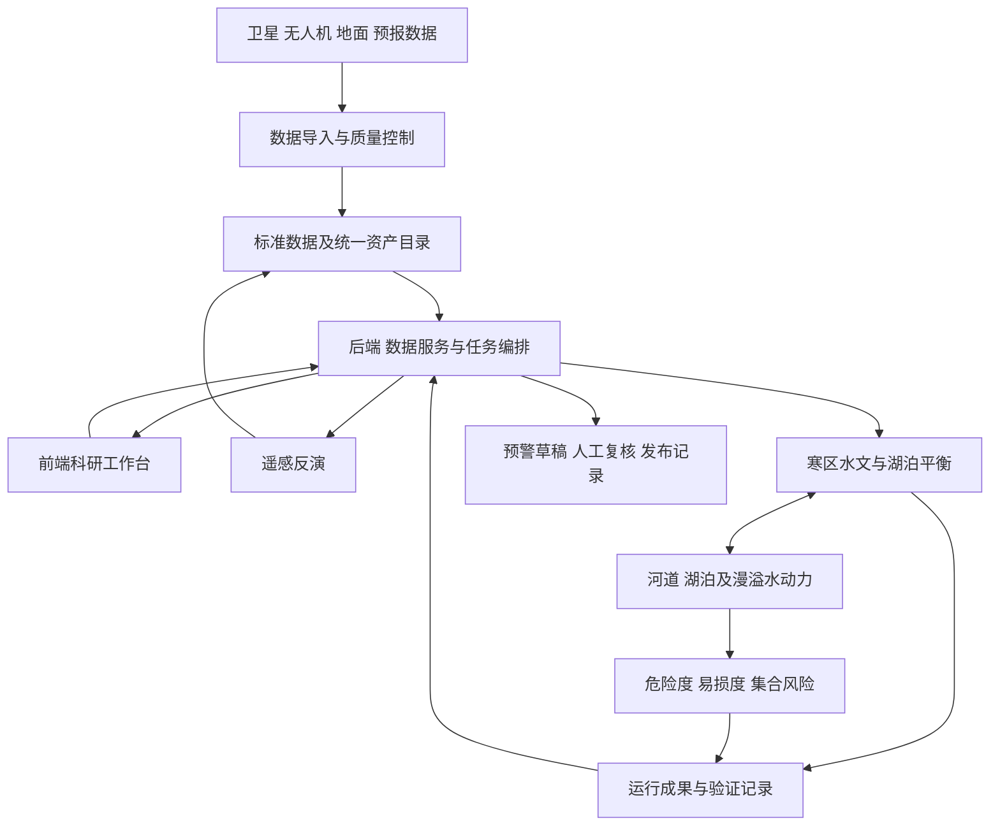

# 系统架构与接口契约

## 总体选择

采用模块化单体后端加独立计算进程作为初始工程方案。现阶段规模不明，不先拆微服务；算法通过稳定任务契约隔离，后续可独立扩容。以下技术是设计建议，不是已安装、已运行或任务书指定的软件。

前端建议沿用旧项目已有的Vue 3、TypeScript、Vite、Element Plus和ECharts生态，其中TypeScript为新项目建议；二维科研地图使用MapLibre，三维地理场景后续按需要接Cesium。后端建议Python FastAPI、Pydantic、SQLAlchemy；初期文件目录加轻量注册库，进入多人和空间查询阶段使用PostgreSQL/PostGIS。大栅格/多维结果保留文件或对象存储，通过索引访问，不塞入普通JSON接口。计算初期使用独立进程，队列规模明确后再选Redis/RQ或其他成熟执行器。

## 数据与调用关系

文件处理由工具或后端导入服务发起，科学转换调用算法模块。禁止分别在前端、后端、脚本复制水量平衡公式。遥感产品只有通过质量控制后才能注册为正式模型输入。

## 业务工作台

| 视图 | 日常操作 | 必要状态与关联 |
|---|---|---|
| 流域总览 | 选择湖泊、河段、站点，查看最新有效时间、覆盖和风险摘要 | 无数据、过期、异常独立展示；点击对象进入同一对象详情 |
| 监测资料 | 地面/遥感/无人机图层、站点过程线、数据质量与来源 | 空间对象与时间筛选一致；有观测不代表实时在线 |
| 遥感与演变 | 按产品和日期查看湖界、冰川、形变、活动层；比较时期 | 展示产品类型、观测时间、分辨率、单位、置信度与有效掩膜 |
| 模型与实验 | 选择数据版本、模型、参数、初始状态；率定、验证、历史回放 | 缺必需输入禁止提交；率定和验证时期分离 |
| 情景与洪水演进 | 对比湖位、入出流、水深、流速、淹没范围及到达时间 | 同一运行编号联动地图、时序与配置；二维为工作主视图，三维用于地形关系 |
| 风险与预警 | 查看集合概率、承灾体、风险单元、预警草稿及复核 | 研究情景与业务预报明显区分；阈值有版本和依据 |
| 成果与追溯 | 查询、对比和导出数据集、运行和验收材料 | 导出携带模型/数据版本、时间、单位及质量说明 |

使用高信息密度、克制的科研业务界面：固定导航、地图主视区、时间轴、可折叠对象面板、图表和表格联动。保留清晰图例与量纲；风险颜色具有确定语义，未知不显示为安全。设计遵循frontend-design的场景判断，不做营销页或装饰大屏。三维展示必须服从空间分析需要。

移动端以监测查看和预警复核为主，复杂率定配置优先桌面完成。后续开发须验证桌面及移动视口、长名称、空数据、失败任务和地图加载失败状态。

## 统一对象合同

## P02工作台与流程定稿（2026-09-16）

导航归并为六个业务入口，遥感与演变归入天空地监测，情景演进归入模型预报和漫溢风险。共享选择状态为 object_id、dataset_id/version、run_id 和有效时间；切换入口不得用名称重新关联对象。

| 入口 | 页面职责与操作 | 首期数据条件 |
|---|---|---|
| 流域一张图 | 图层开关、对象检索与定位、边界及位置详情、关联资料 | P03实现候选总边界、四子流域、静态湖界、四个降水位置；非正式监测台账 |
| 天空地监测 | 按地面/卫星/无人机和变量查询产品、时间覆盖及质控；关联对象 | P04；无序列时显示未接入，不显示零值或在线 |
| 模型预报 | 输入检查、方案与起报配置、运行状态、取消、结果审查 | P05；缺驱动、模型或初始边界则阻断提交 |
| 漫溢风险 | 同一运行下的淹没、水深、到达时间和承灾体叠加，集合成员比较 | P06；无承灾体时仅为危险度，无结果时风险未知 |
| 预警管理 | 草稿、复核意见、有效期及发布记录 | P06；研究情景不能进入业务发布；发布依赖真实角色和渠道 |
| 成果与运行 | 资料目录、来源质量、运行配置和结果版本追溯 | P03先实现资料目录；运行与导出后续扩展 |

| 步骤 | 输入与输出 | 阻断或异常处理 |
|---|---|---|
| 资料检查 | 对象、时窗、数据版本 → 缺测/基准/单位/覆盖检查结果 | 不满足模型必需变量时返回具体缺项 |
| 方案配置 | 模型参数版本、初始边界、起报时刻 → 不可变运行配置 | 历史回放用历史驱动；研究情景标注假设；业务预报仅用起报时可获得资料 |
| 模型运行 | 已通过输入检查的配置 → 状态、日志、结果索引 | 失败保留原因；取消保留文件；重试新run_id并记录parent_run_id；恢复需检查点兼容证据 |
| 成果审查 | 结果索引、守恒及验证记录 → 审查结论 | 文件存在不等于计算有效；无验证不得提升为业务能力 |
| 风险研判 | 审查通过的运行、承灾体、判据版本 → 风险产品 | 缺判据或承灾体明确限制，不据此生成安全结论 |
| 预警复核 | 业务预报依据、阈值版本、有效期 → 通过/退回及意见 | 草稿→待复核→通过/退回→发布记录；过期和撤回留痕；无权限不得发布 |
| 留痕复盘 | 运行、审查、发布和事后观测 → 可追溯复盘 | 不改写旧运行或旧结论，订正生成关联新版本 |

P03可检查的最小API定为：`GET /api/v1/health`、`/objects`（type、q筛选）、`/objects/{id}`、`/datasets`（object_id筛选）、`/layers/{dataset_id}`（GeoJSON）。列表统一返回items和total；详情及图层未知ID为404，参数不合法为422，标准目录缺失或损坏为503。坐标输出为EPSG:4326，经度在前。对象详情携带bbox、dataset_ids及质量限制，数据集返回来源类别、标准版本、单位、CRS、时间覆盖和来源文件名/哈希，不返回本地绝对路径。湖水位、降水与流量无输入时不生成数值接口。其余API仍为后续合同，不能宣称已实现。

验收：原件哈希不变；修复输出有效且报告面积/拓扑变化；对象列表、图层与详情ID一致；浏览器可点选、筛选、定位和切换图层；资料缺失、未知ID、API故障及手机布局有明确状态。首版仅本机只读原型，未实现鉴权，不绑定公网。

## 对象字段与单位

| 对象 | 关键字段及关系 |
|---|---|
| 流域/湖泊/河段/站点/网格 | 稳定ID、中文名称、类型、几何版本、所属流域、有效期；河湖连接单独建拓扑边，允许多级汇入和分流 |
| 数据集版本 | dataset_id、version、来源类型、来源路径/URI、哈希、许可/共享范围、CRS、垂直基准、时区、时间范围、变量字典、质量状态 |
| 观测或反演值 | 对象ID、变量、观测时间、接收时间、值、单位、质量标志、不确定性、数据集版本；预测另记起报时间与有效时间 |
| 模型与参数版本 | model_id、代码版本、过程模块、必需变量、空间尺度、时间步、参数边界、适用范围与验证记录 |
| 运行 | run_id、类型、输入版本、模型和参数版本、起止时间、起报时刻、集合成员、初始状态、边界、配置哈希、状态与输出索引 |
| 风险/预警 | 对象或风险单元ID、run_id、预见期、概率、阈值版本、依据、有效期、复核人、状态及发布记录 |

时间序列接口使用带时区ISO 8601；内部采用统一UTC或明确的标准时间，前端转换为指定展示时区。原始北京时间记录转换过程必须留痕。水位保存高程及基准，不仅一个裸数；流量m³/s、降水需明确累计mm或强度mm/h；湖面积与栅格面积不得由经纬度直接相乘。

原始资料只读。地图显示几何和轻量产品由标准版本导出；大型格网接口应支持包络、时间、变量和分辨率请求，限制单次响应规模。

## API与任务合同草案

| 接口 | 职责 |
|---|---|
| GET /api/v1/objects | 按对象类型与范围查询；返回对象ID、名称和几何引用 |
| GET /api/v1/datasets | 数据版本、质量、时间覆盖、变量与来源 |
| GET /api/v1/observations | 按对象/变量/时间窗查询，返回单位、质量和数据版本 |
| POST /api/v1/runs | 提交历史回放、率定、验证、情景或集合预报配置；返回run_id |
| GET /api/v1/runs/{id} | 查询状态、阶段、进度、消息及失败原因 |
| POST /api/v1/runs/{id}/cancel | 停止计算并保留检查点、日志和已有结果 |
| GET /api/v1/runs/{id}/results | 获取结果目录、变量、单位、空间和时间覆盖 |
| GET /api/v1/products/{id} | 返回经过权限检查的图层、时序或文件引用 |
| POST /api/v1/warnings | 创建带运行依据与阈值版本的预警草稿 |
| POST /api/v1/warnings/{id}/review | 记录复核结论；外部发布需配置实际权限和渠道 |

采用OpenAPI作为后续契约源。请求校验错误返回可定位字段，缺数据不补演示值；不存在与无权限分开处理。提交支持幂等键，重试生成或复用明确运行，不重复启动不可见作业。任务状态为：排队 → 运行 → 成功/失败/已取消；取消中单独记录，成功必须有经过检查的结果索引。

结果输出到 `成果/模型运行/<运行编号>/`，含配置、输入清单、运行日志、检查点、结果索引与验证报告。大批量任务通过后台进程运行，不阻塞HTTP请求。并发任务不得共用可写临时文件；保留所有已有文件，目录名冲突时生成新编号。

## 部署与权限边界

开发环境先保证Windows中文路径可用，重型SAR或水动力求解器可通过经过验证的独立Linux环境运行。先记录依赖和版本，再选择容器；任何自动清理步骤都受全局禁止删除约束。

角色建议为查看者、科研分析者、数据管理员、预警复核者，按实际人员配置；账户与密钥不写入版本文件。接入监测设备和发布渠道必须有真实协议与权限证据。工程实时调度先管理对象、方案及审批记录，待确认实际工程和通信控制能力后再接入执行链路。
